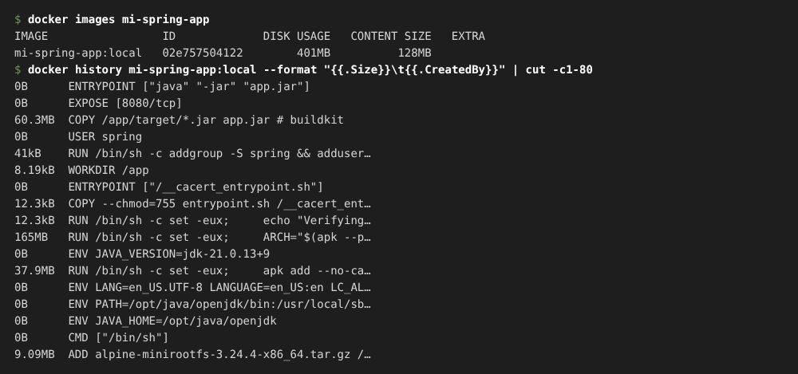
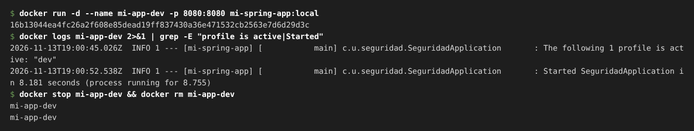
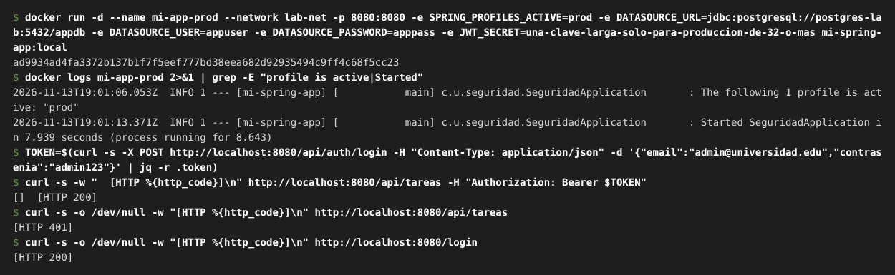
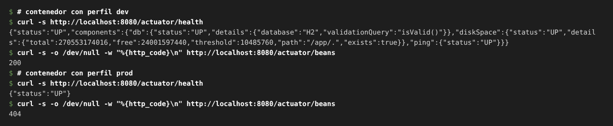
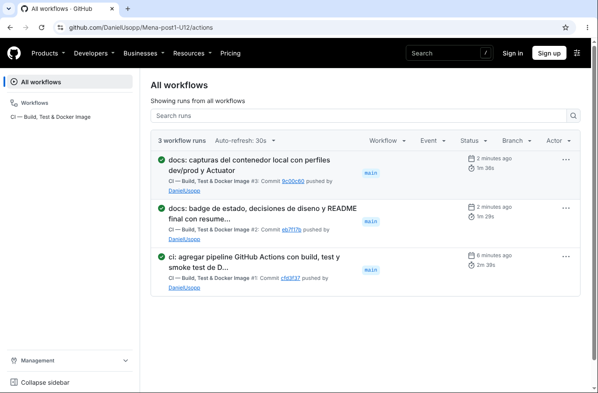
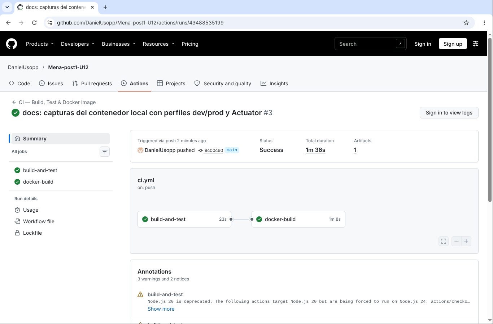
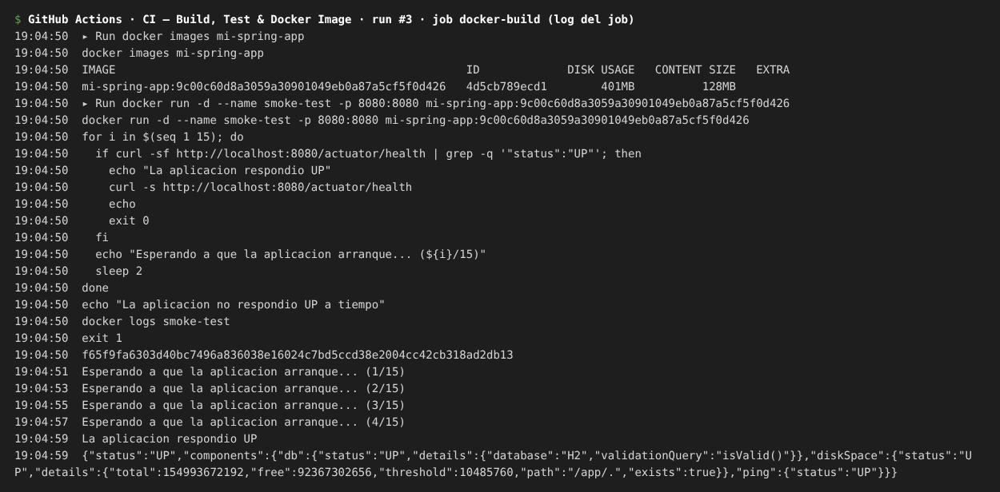

# Post-contenido — Unidad 12: Despliegue y CI/CD

## Descripción
Repositorio del laboratorio de la Unidad 12 de Programación Web —
Séptimo Semestre. Contiene la aplicación Spring Boot dockerizada
con un Dockerfile multi-stage y perfiles dev/prod (Parte 1), y su
extensión con un pipeline de integración continua con GitHub
Actions y monitoreo con Spring Boot Actuator (Parte 2).


La aplicación es la de la Unidad 9 (Usuario/Tarea con login por
sesión para las vistas Thymeleaf y API REST con JWT en `/api/**`),
traída en el primer commit y adaptada aquí para correr en contenedor.

## Parte 1 — Dockerización con Perfiles y Variables de Entorno
El Dockerfile multi-stage compila el proyecto con Maven en una
etapa JDK y ejecuta el JAR resultante en una etapa JRE Alpine con
un usuario no root. La configuración sensible se externaliza en
application.properties con placeholders ${VAR:default}: sin
variables de entorno, la aplicación arranca con el perfil dev
(H2 en memoria); con SPRING_PROFILES_ACTIVE=prod y las variables
DATASOURCE_URL / DATASOURCE_USER / DATASOURCE_PASSWORD y
JWT_SECRET, arranca con la configuración de producción.

### Variables de entorno
| Variable | dev (valor por defecto) | prod |
|---|---|---|
| `SPRING_PROFILES_ACTIVE` | `dev` | `prod` |
| `PORT` | `8080` | lo asigna la plataforma |
| `DATASOURCE_URL` | `jdbc:h2:mem:devdb` | `jdbc:postgresql://<host>:5432/<bd>` |
| `DATASOURCE_USER` | `sa` | usuario de la BD |
| `DATASOURCE_PASSWORD` | vacío | contraseña de la BD |
| `JWT_SECRET` | clave de desarrollo | **obligatoria**, mínimo 32 caracteres (sin ella la app no arranca) |

En prod las tablas se crean con `schema-postgresql.sql`
(`CREATE TABLE IF NOT EXISTS`) y Hibernate solo las valida
(`ddl-auto=validate`). En dev se cargan dos usuarios de prueba
(`admin@universidad.edu` / `admin123` y `laura@correo.com` /
`laura123`), porque H2 arranca vacía en cada ejecución.

### Resultados de la Parte 1
- `docker build` construye la imagen sin errores. Las capas suman
  unos 272 MB (Alpine + JRE 21 ≈ 212 MB y el JAR ≈ 60 MB); comprimida
  pesa 128 MB. Con el almacén de imágenes de containerd, `docker images`
  muestra además "DISK USAGE" (≈ 400 MB) porque cuenta la copia
  comprimida y la descomprimida.
- Sin variables de entorno el contenedor arranca con el perfil `dev`.
- Con `SPRING_PROFILES_ACTIVE=prod` y PostgreSQL (contenedor
  `postgres:16-alpine` en una red de Docker) los logs muestran el
  perfil `prod`, el login por API devuelve token y `/api/tareas`
  responde 200 con token y 401 sin él.
- Con el perfil prod y sin `JWT_SECRET`, la aplicación no arranca
  (falla al crear `JwtUtil`): es intencional, ver la decisión 1.

## Parte 2 — Pipeline CI/CD con GitHub Actions y Monitoreo con Actuator
El pipeline se activa automaticamente en cada push a `main` (y en
cada pull request hacia `main`) y realiza:
1. **Job `build-and-test`**: compilación con Maven y ejecución de
   pruebas (`mvn -B clean verify`) con JDK 21 y caché de Maven
   (`actions/setup-java` con `cache: maven`). Publica los reportes de
   Surefire como artefacto aunque las pruebas fallen.
2. **Job `docker-build`** (`needs: build-and-test`, solo corre si las
   pruebas pasaron): construcción de la imagen Docker con el mismo
   Dockerfile multi-stage de la Parte 1.
3. Smoke test: levanta el contenedor recién construido dentro
   del propio runner y verifica que /actuator/health responde UP
   (hasta 15 intentos con 2 s entre cada uno), sin publicar la imagen
   en ningún registro externo. El contenedor se elimina al final con
   `if: always()`, aunque el smoke test falle.

Spring Boot Actuator expone en dev todos los endpoints con detalle
completo, y en prod solo `health` e `info` (en prod
`/actuator/beans` responde 404 y `/actuator/health` responde
`{"status":"UP"}` sin detalles). La prueba
`ApplicationContextTest` levanta el contexto con el perfil dev y
verifica que `/actuator/health` responde UP sin login y que
`/api/tareas` sin token responde 401.

## Despliegue (paso final manual)
La plataforma (Railway o Render) construye la imagen a partir del
mismo Dockerfile del repositorio; el workflow de GitHub Actions no
necesita ningún Secret de la plataforma.

Pasos en Railway:
1. Entrar a railway.app con la cuenta de GitHub y crear un proyecto
   con "Deploy from GitHub repo" → `Mena-post1-U12`.
2. Agregar una base de datos PostgreSQL al proyecto.
3. En el servicio de la app, configurar las variables:
   `SPRING_PROFILES_ACTIVE=prod`,
   `DATASOURCE_URL=jdbc:postgresql://${{Postgres.PGHOST}}:${{Postgres.PGPORT}}/${{Postgres.PGDATABASE}}`,
   `DATASOURCE_USER=${{Postgres.PGUSER}}`,
   `DATASOURCE_PASSWORD=${{Postgres.PGPASSWORD}}` y `JWT_SECRET`
   (32 caracteres o más). Railway entrega `DATABASE_URL` en formato
   `postgresql://...`, que no es una URL JDBC; por eso se arma
   `DATASOURCE_URL` con las variables sueltas.
4. Generar el dominio público y verificar
   `https://<app>.up.railway.app/actuator/health` → `{"status":"UP"}`.

Estado: pendiente de hacer con la cuenta del dueño del repositorio.

## Decisiones de diseño

### Parte 1
1. Placeholders con valor por defecto (${VAR:default}) en vez de
   placeholders estrictos: permite arrancar sin friccion en local
   y en CI, dejando los valores reales para produccion. La excepción
   es `JWT_SECRET` en prod: no tiene un valor por defecto utilizable,
   para que nunca se despliegue con una clave conocida.
2. application-dev.properties y application-prod.properties como
   archivos separados: hace explicito que configuracion corresponde
   a cada ambiente.
3. Imagen final eclipse-temurin JRE Alpine en vez de distroless:
   reduce el tamano de la imagen sin sacrificar la posibilidad de
   depurar el contenedor con docker exec.
4. Etapa de compilación con `maven:3.9.9-eclipse-temurin-21-alpine`
   en vez de `eclipse-temurin:21-jdk-alpine`: la imagen de Temurin sola
   es un JDK sin Maven, así que `RUN mvn ...` fallaría. La de Maven es
   el mismo JDK 21 de Temurin con Maven instalado. Tampoco se usa el
   wrapper `mvnw`, porque el `.dockerignore` excluye `.mvn/`.
5. PostgreSQL en prod con `schema-postgresql.sql`: con
   `ddl-auto=validate` Hibernate no crea tablas, así que en una base
   nueva (como la de Railway) la app no arrancaría; el script crea las
   tablas solo si no existen y luego Hibernate valida que coincidan con
   las entidades.

### Parte 2
1. Prueba de contexto en vez de omitir la fase de pruebas:
   garantiza que el job de CI valide algo real. Aquí además de
   `contextLoads` se comprueba `/actuator/health` y el 401 de la API,
   que es justo lo que el smoke test y la app necesitan.
2. El job docker-build construye y verifica la imagen con un smoke
   test contra /actuator/health, pero no la publica en ningun
   registro: evita exigir una cuenta externa y Secrets solo para
   aprobar el laboratorio.
3. Exposicion de Actuator diferenciada por perfil (todos los
   endpoints en dev, solo health e info en prod): evita exponer
   publicamente informacion sensible como variables de entorno.
4. `/actuator/**` permitido en Spring Security sin login: si no, la
   app (que viene de la Unidad 9 con seguridad) redirigía
   `/actuator/health` al formulario de login y el smoke test nunca
   vería `UP`. Qué endpoints existen lo sigue decidiendo
   `management.endpoints.web.exposure.include` según el perfil.

## Cómo compilar y ejecutar
1. Clonar el repositorio: `git clone https://github.com/DanielUsopp/Mena-post1-U12.git`
2. Construir la imagen localmente: `docker build -t mi-spring-app:local .`
3. Ejecutar con los valores por defecto (perfil dev): `docker run -p 8080:8080 mi-spring-app:local`
4. Ejecutar con perfil prod:
   ```bash
   docker run -p 8080:8080 -e SPRING_PROFILES_ACTIVE=prod \
     -e DATASOURCE_URL=jdbc:postgresql://host.docker.internal:5432/appdb \
     -e DATASOURCE_USER=appuser -e DATASOURCE_PASSWORD=apppass \
     -e JWT_SECRET=una-clave-larga-solo-para-produccion mi-spring-app:local
   ```
5. Verificar el estado: `curl http://localhost:8080/actuator/health`
6. Consultar el pipeline en la pestaña Actions del repositorio

Sin Docker: `./mvnw spring-boot:run` (perfil dev) y `./mvnw verify` para las pruebas.

## Capturas de pantalla








El log del smoke test se tomó del job `docker-build` de la ejecución
#3 (descargado desde la API de Actions, porque GitHub no muestra los
logs en la web sin iniciar sesión).
